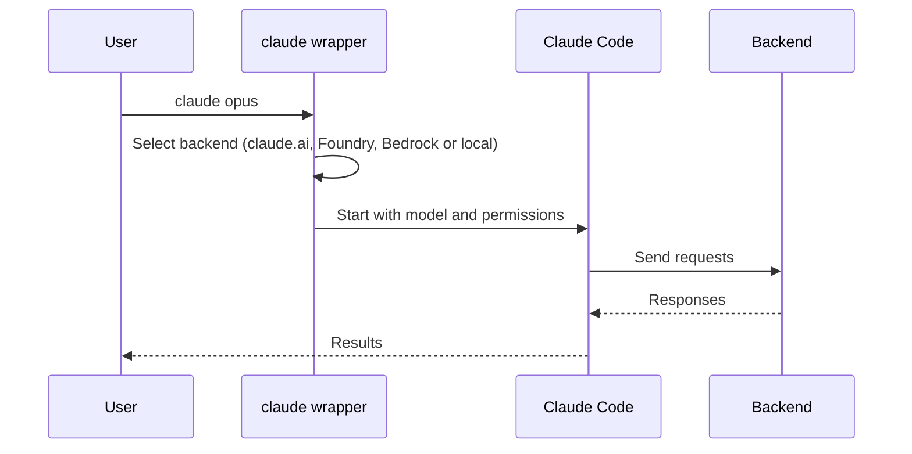

# Tips for Claude Code

The agent now does most of the typing. It writes the code and it selects the language. Your work moves up to a higher level: you tell the agent what you need, and you make sure that you understand what it did.

This page gives tips that make the output of the agent easier to read, check and understand. Many of them come from a [post by Andrej Karpathy](https://x.com/karpathy) about how to understand the outputs of language models.

## Must have: Ponytail

[Ponytail](https://github.com/dietrichgebert/ponytail) is a skill that makes the agent work like a lazy senior developer: it writes only the code that the task needs. Install it before you do anything else.

Before the agent writes new code, Ponytail makes it stop at the first step that solves the problem:

1. Is this code necessary?
2. Is it already in this codebase?
3. Does the standard library do it?
4. Is it a native feature of the platform?
5. Does an installed dependency do it?
6. Can it be one line?
7. Only then: write the minimum code that works, plus one small test if the code has logic.

It is lazy about the solution, not about the work. It reads the code that the change touches before it selects a step, and it never removes validation, error handling, security or accessibility. Each reply ends with what it did not do or did not check.

Less code means less code for you to read and understand. This is the same goal as the other tips on this page. The author's benchmark in Claude Code shows approximately half the code, less time and less cost, with more tests for risky logic. See the [numbers](https://github.com/dietrichgebert/ponytail#numbers).

**Install in Claude Code** (two separate prompts):

```text
/plugin marketplace add DietrichGebert/ponytail
```

```text
/plugin install ponytail@ponytail
```

After the install, Ponytail is active in each session. Useful commands:

| Command | What it does |
|---------|--------------|
| `/ponytail lite`, `full`, `ultra` or `off` | Set the intensity, or turn it off. |
| `/ponytail-review` | Review the current change: bugs, security, load, missing tests, slow code and code to remove. |
| `/ponytail-audit` | The same review for the full repository, most important problem first. |
| `/ponytail-debt` | Collect the `shortcut:` comments into a list, so that "later" does not become "never". |
| `/ponytail band` | Show or hide the band above the prompt with cost, tokens, agent time and test results. |

!!! warning "Install only from the original source"
    Install Ponytail only from `DietrichGebert/ponytail` on GitHub or `@dietrichgebert/ponytail` on npm. The author says that it never contains `.exe` or `.dll` files. A copy that does is not genuine.

## Must have: Anthropic skills

A skill is a folder with a `SKILL.md` file. It contains instructions, scripts and resources that teach the agent one task. Claude Code loads a skill only when the task needs it. Anthropic publishes its own skills in [anthropics/skills](https://github.com/anthropics/skills). Two plugins from this repository are must haves.

**Office documents** (`document-skills`): Word (`docx`), Excel (`xlsx`), PowerPoint (`pptx`) and PDF (`pdf`). These are the same skills that create and edit files in claude.ai. With them, the agent can read, create and change real Office files, for example a report with a table of contents, a spreadsheet with working formulas or a slide deck from a template. It can also fill PDF forms, merge PDFs and extract text and tables.

**Skill creator** (`skill-creator`, in `example-skills`): it helps you make your own skills. When you do the same task again and again, ask the agent to make a skill for it. The skill creator writes the `SKILL.md`, tests the skill and improves its description so that Claude Code uses it at the correct time.

**Install in Claude Code:**

```text
/plugin marketplace add anthropics/skills
```

```text
/plugin install document-skills@anthropic-agent-skills
```

```text
/plugin install example-skills@anthropic-agent-skills
```

The `example-skills` plugin also contains other useful skills, for example `frontend-design` for better web pages (see [tip 5](#5-ask-for-a-web-page)) and `webapp-testing`.

After the install, you do not need a special command. Tell the agent what you need, and it uses the skill:

```text
Make a Word report from results.csv with a summary table and a chart.
```

```text
Make a skill that converts our lab notebook exports to the format of our LIMS.
```

!!! note "License"
    The Office document skills are source-available, not open source. Most of the other skills in the repository use the Apache 2.0 license.

## 1. Ask for technical English (ASD-STE100)

ASD-STE100 is a controlled language. It is also known as Simplified Technical English (STE). The aerospace industry made it for aircraft maintenance documentation, where a misunderstood sentence can cause an accident.

The rules are strict, for example:

- Use short sentences. Procedural sentences have a maximum of 20 words, descriptive sentences a maximum of 25 words.
- Use one word for one meaning. Do not use synonyms for variety.
- Use the active voice.
- Write one instruction in one sentence.
- Put the most important information first.

Language models know this specification well. When you ask for it, you get text that is shorter, clearer and easier to scan than the default style. This is very useful when the agent explains a change, a bug or a design.

```text
Explain why this test fails. Use ASD-STE100.
```

**Default style:**

> It looks like the test is failing because, under certain circumstances, the cache might not have been fully invalidated before the assertion runs, which could potentially lead to stale data being returned.

**ASD-STE100:**

> The test fails because the cache contains old data. The code does not clear the cache before the assertion. Clear the cache in the setup function.

## 2. Use sliders

The full ASD-STE100 specification is very strict. Sometimes it removes nuance that you need. Do not select "on" or "off". Use a **slider**: give a percentage.

```text
Explain this design. Write 80% of the way to ASD-STE100.
```

The model treats the number as an approximate setting, not as an exact measurement. But it understands the direction, and you can move the slider up or down until the result is correct for you.

The same method works for many other properties of the output:

| Slider | Example prompt |
|--------|----------------|
| Writing style | "Write 80% of the way to ASD-STE100." |
| Detail | "Give me the 20% version. I will ask for more if I need it." |
| Reader level | "Explain this for a first-year student." or "for a senior engineer" |
| Length | "Use a maximum of 5 sentences." |
| Certainty | "Tell me how sure you are about each point, from 0 to 100%." |

You can combine sliders in one prompt:

```text
Summarize this pull request for a new team member.
Use 70% ASD-STE100 and a maximum of 10 sentences.
```

## 3. Make the style permanent with CLAUDE.md

Do not type the same instruction in each session. Put it in a `CLAUDE.md` file. Claude Code reads this file at the start of each session.

- `~/.claude/CLAUDE.md` applies to all your projects.
- `CLAUDE.md` in the root of a repository applies to that project only.

Example of a global `~/.claude/CLAUDE.md`:

```markdown
## Writing style

- Adhere to ASD-STE100 technical English as much as possible.
  Deviate only when nuance is required.
- Write in plain, easy to understand English.
  Do not use AI-specific decoration, for example em dashes.
```

The phrase "deviate only when nuance is required" is a slider that is built into the rule. The model uses strict STE by default and relaxes it only where it must.

## 4. Ask for a diagram

A diagram is often easier to understand than text. Ask the agent to draw the structure, the data flow or the sequence of events.

```text
Show the authentication flow of this app as a Mermaid sequence diagram.
```

Mermaid diagrams are plain text, so you can keep them in Markdown files and in Git. This site renders them, as in this example:



GitHub also renders Mermaid diagrams in Markdown files, issues and pull requests.

## 5. Ask for a web page

Ask for the output "as a single HTML file". Language models are now good at frontend work. You get an interactive page with layout, colors and sometimes animations, which is often much easier to explore than a long text.

```text
Explain how our CI pipeline works. Make a single HTML file
with a diagram I can click on for details. Then open it.
```

On WSL, Claude Code can open the file in your Windows browser with `explorer.exe file.html`. On Linux use `xdg-open`, on macOS use `open`.

## 6. Ask for an explainer video

An explainer video is the most powerful output format for difficult topics, and it starts to work now. A good example is a video in the style of [3Blue1Brown](https://www.3blue1brown.com/), which uses the [Manim](https://www.manim.community/) animation library.

```text
Create a 3Blue1Brown-style video that explains how a hash table works.
Use Manim. Add narration with my ElevenLabs API key.
```

For the narration, you need an API key for a text-to-speech service. If you do not have one, ask the agent to find a free alternative that runs on your own computer. Expect to do some iterations before the result is good.

## 7. Make discardable software

Code is now cheap. Software that was too expensive to make before is now possible: a web app, a video or a small tool that you use one time to understand one problem, and then delete.

- Do not ask only "what is the answer?". Ask "make me something that shows me the answer".
- Do not keep these artifacts if you do not need them. Their purpose is understanding, not maintenance.

## Summary

- The agent does more of the work. Your work moves to **oversight and understanding**.
- Install **Ponytail** so that the agent writes only the code that the task needs.
- Install the **Anthropic skills** for Office documents, and use the **skill creator** to make your own skills.
- Ask for **ASD-STE100** to get clear text, and use **sliders** to set how strict it is.
- Put your preferred style in **CLAUDE.md** so that it applies to each session.
- Ask for **diagrams**, **web pages** and **videos** when text is not the best format.
- Make **discardable artifacts** that help you understand, then delete them.
